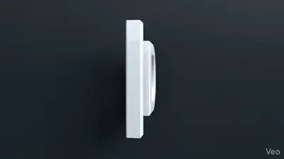
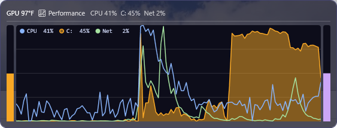
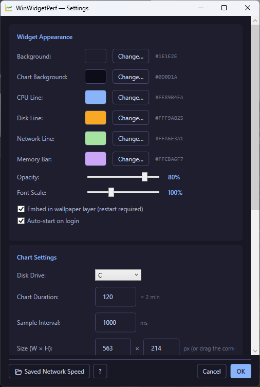
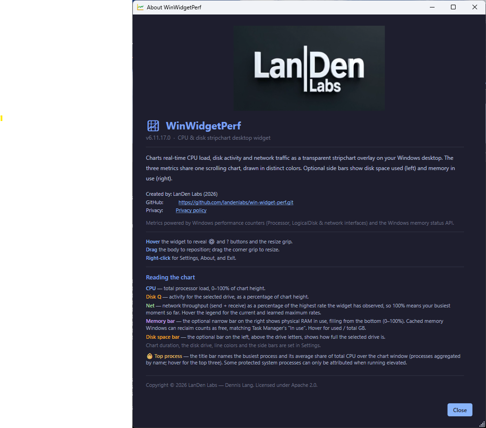

<table border="0">
  <tr>
    <td>
      07-Jun-2026<br>
      Windows<br>
      <a href="https://landenlabs.com/index.html">Home</a>
    </td>
    <td>
      <a href="https://landenlabs.com/index.html">
        
      </a>
    </td>
  </tr>
</table>

# WinWidgetPerf

[](https://github.com/landenlabs/win-widget-perf/actions/workflows/build.yml)


[](https://apps.microsoft.com/detail/9NX4ZTQV9TP1)

A lightweight Windows desktop widget that charts real-time **CPU load**, **disk activity** and **network traffic** as a transparent scrolling stripchart directly on your desktop wallpaper, with optional memory and disk-space bars and CPU/GPU temperatures. All metrics share one chart, drawn in distinct colors. Built with WPF and .NET 10.

**By [LanDen Labs](https://github.com/landenlabs) (2026)**

---

## Screenshots

**Widget**



The title bar names the busiest process and its average share of total CPU over the chart window. The legend shows the current CPU load (blue), disk activity (amber) and network load (green); click a legend item to switch that series between a line and a filled area.

**Settings dialog**



**About dialog**



---

## Features

- **Multi-metric stripchart** — CPU load, disk activity and network load (0–100%) on a single scrolling chart, each in its own color, drawn as lines or filled areas
- **Busiest-process readout** — the title bar names the process consuming the most CPU using a rolling average over the chart window, aggregated by name (all `chrome` children sum together); hover for the top three
- **Per-drive disk monitoring** — pick any fixed drive (defaults to `C`); plots the percent of time the drive was active (Task Manager's disk "% Utilization")
- **Optional side bars and temperatures** — disk space used (left), physical memory in use (right), and CPU/GPU temperatures in the title bar
- **Configurable duration** — set the total time span shown across the chart (default 2 minutes)
- **Resizable** — drag the corner grip to resize the widget, or set an exact size in Settings; the chart re-flows to fit
- **Transparent overlay** — sits directly on the desktop wallpaper, no taskbar clutter
- **Drag to reposition** — click and drag the widget anywhere on the desktop *(Windows 11)*
- **Screen-map position picker** — drag a scaled widget marker across a miniature monitor map inside Settings to reposition the widget *(Windows 10 & 11 — see [Windows 10 notes](#windows-10-notes))*
- **Multi-monitor aware** — position saved per monitor layout; a widget left on an unplugged monitor is moved back onto a remaining screen
- **Fully customizable** — background, chart background, CPU and disk line colors, opacity, font scale, sample interval, and component visibility (title, legend, grid lines, top process)
- **Multiple widgets** — add or remove widget instances from the system tray menu
- **Wallpaper embed mode** — render the widget at the wallpaper layer (below all windows)
- **Auto-start on login** — optional launch with Windows
- **Dark theme** — Catppuccin Mocha palette throughout
- **Persistent settings** — saved to `%AppData%\WinWidgetPerf\settings.json`

---

## Requirements

- Windows 10 or Windows 11 (x64 or ARM64)
- No .NET install needed for the release builds — the MSIX and zip are self-contained
- Framework-dependent builds from source need the [.NET 10.0 Desktop Runtime](https://dotnet.microsoft.com/en-us/download/dotnet/10.0)

Metrics are read from Windows performance counters (`Processor` and `LogicalDisk`) and per-process CPU times. Running non-elevated, a few protected system processes cannot be attributed to the busiest-process readout — run elevated to include them.

---

## Windows 10 Notes

### Drag limitation

On **Windows 10**, the desktop widget cannot be dragged directly on screen. This is caused by a Windows 10 incompatibility between WPF's `AllowsTransparency` and `WindowStyle="None"` — the combination that transparent widgets require. The drag operation silently fails, and wallpaper-embed mode is unavailable.

**Windows 11** does not have this limitation; direct drag and wallpaper embedding work normally.

### Workaround — Screen-map position picker

Open **Settings** (hover the widget and click ⚙, or right-click → Settings) and scroll to the **Widget Position** panel:

```
Widget Position ─────────────────────────────── X: 120  Y: 200
┌──────────────────────────────────────────────────────────────┐
│  ┌────────────────────────────┐  ┌─────────────────────┐    │
│  │  Primary                   │  │  2560×1440          │    │
│  │        ▓▓▓▓▓               │  └─────────────────────┘    │
│  └────────────────────────────┘                              │
└──────────────────────────────────────────────────────────────┘
  Drag the blue marker to reposition the widget — it moves live.
```

- The canvas shows **all connected monitors** scaled to fit
- The **blue marker** represents the widget at its current position
- Drag the marker to the desired location — **the widget moves live** as you drag
- Click **OK** to keep the new position, or **Cancel** to restore it

This approach works on Windows 10 because the Settings dialog is a normal opaque window that does not require transparency.

---

## Installation

See **[how-to-install.md](how-to-install.md)** for full details — every install option, why the MSIX is signed with a self-signed certificate, which Windows security features (SmartScreen, Smart App Control) can still block the app, and how to uninstall.

### Microsoft Store (recommended)

Install **WinWidgetPerf** from the [Microsoft Store](https://apps.microsoft.com/detail/9NX4ZTQV9TP1) (product ID `9NX4ZTQV9TP1`). The Store signs the package and keeps it updated, so there is no certificate to trust and no SmartScreen warning.

### Option A — MSIX installer from GitHub

1. From [Releases](https://github.com/landenlabs/win-widget-perf/releases) download `WinWidgetPerf-<version>-x64.msix` (or `-arm64.msix`) and `install-msix.ps1` into the same folder
2. Run it from a normal (non-admin) PowerShell:
   `powershell -ExecutionPolicy Bypass -File .\install-msix.ps1`
   It picks the `.msix` matching your CPU, trusts its self-signed certificate (one UAC prompt), installs, and launches the app. It shows up in the Start menu as **WinWidgetPerf**.

> Windows only installs an MSIX whose signing certificate is trusted, so the self-signed certificate must be added to **Local Machine → Trusted People** first — the script does this for you.  
> To remove the app and the certificate later: `powershell -ExecutionPolicy Bypass -File .\uninstall-msix.ps1`  
> The certificate is shared by all LanDen Labs widgets, so it is kept while any of them is still installed (add `-Force` to remove it anyway).

### Option B — Portable release zip

1. Download `WinWidgetPerf.zip` from [Releases](https://github.com/landenlabs/win-widget-perf/releases)
2. Right-click the zip → **Properties** → tick **Unblock** → **OK**
3. Extract to any folder (e.g. `C:\opt\bin\winwidgets\`) and run `WinWidgetPerf.exe`

> The zip contains a single self-contained `WinWidgetPerf.exe` (assets bundled inside) — no .NET runtime needed. The exe is unsigned, so SmartScreen may warn (**More info → Run anyway**).

### Option C — Build from source

```cmd
git clone https://github.com/landenlabs/win-widget-perf.git
cd win-widget-perf
build.bat C:\opt\bin
```

`build.bat <dest-dir>` publishes a self-contained single-file exe to `<dest-dir>\winwidgets\` and writes a `<dest-dir>\WinWidgetPerf.bat` launcher. With no argument it uses the `BINDIR` environment variable.

---

## Usage

| Action | Result |
|--------|--------|
| **Hover** | Reveals ⚙ Settings and ? About buttons, and the corner resize grip |
| **Drag body** | Repositions the widget *(Windows 11 only — use Settings on Windows 10)* |
| **Drag corner grip** | Resizes the widget |
| **Hover title** | Tooltip lists the top three CPU-consuming processes |
| **Right-click** | Opens context menu (Resource Monitor / Settings / About / Remove / Exit) |

---

## Reading the chart

| Series | Meaning |
|--------|---------|
| **CPU** (blue) | Total processor load, 0–100% of the chart height |
| **Disk** (amber) | Percent of time the selected drive was active/busy, 0–100% of the chart height (matches Task Manager's disk "% Utilization") |
| **🔥 Top process** | The busiest process and its average share of total CPU over the chart window (processes aggregated by name) |

---

## Settings

Access via right-click → **Settings** or the tray icon menu.

### Widget Appearance

| Setting | Description |
|---------|-------------|
| Background | Widget background color |
| Chart Background | Plot-area background color |
| CPU Line | Color of the CPU trace |
| Disk Line | Color of the disk-active trace |
| Opacity | Transparency of the whole widget (frame, chart, text and bars), 10–100% — updates live |
| Font Scale | Text size 50–200% — updates live |
| Embed in wallpaper layer | Places widget behind all windows (requires restart) |
| Auto-start on login | Launch the widget when Windows starts |

### Chart Settings

| Setting | Description |
|---------|-------------|
| Disk Drive | Fixed drive whose activity is charted (default `C`) |
| Chart Duration | Total time span shown across the chart, in seconds (default 120 = 2 min) |
| Sample Interval | How often metrics are sampled (milliseconds) |
| Size (W × H) | Exact widget size in pixels (or drag the corner grip) |
| Title / Legend / Grid Lines | Toggle each chart element |
| Show busiest process in title | Toggle the rolling-average top-process readout |

### Widget Position

A miniature map of your monitor layout. Drag the **blue marker** to move the widget anywhere on any screen. The widget repositions live as you drag. Changes are applied on **OK** and reverted on **Cancel**.

Settings are saved to `%APPDATA%\WinWidgetPerf\settings.json`.

---

## Building from Source

### Prerequisites

- [.NET 10 SDK](https://dotnet.microsoft.com/en-us/download/dotnet/10.0)
- Windows (WPF requires a Windows build host)

### Build

```cmd
dotnet build WinWidgetPerf.csproj -c Release
```

### Publish (FDD single-file, win-x64)

```cmd
dotnet publish WinWidgetPerf.csproj -c Release -r win-x64 --self-contained false -p:PublishSingleFile=true
```

Output: `bin\Release\net10.0-windows10.0.17763.0\win-x64\publish\`

This produces a **single `WinWidgetPerf.exe`** (all managed assemblies bundled) plus the `Assets\` folder. Users need only the .NET 10 Desktop Runtime — no SDK required.

### Build and install via batch script

```cmd
build.bat <dest-dir>
```

Kills any running instance, runs the unit tests, publishes a self-contained, compressed single-file exe (the same build as the release zip), copies it to `<dest-dir>\winwidgets\`, and writes a `<dest-dir>\WinWidgetPerf.bat` launcher. `<dest-dir>` defaults to the `BINDIR` environment variable.

### Unit tests

```cmd
dotnet run --project tests\WinWidgetPerf.Tests
```

The tests use xUnit v3 and run in-process. `dotnet test` also works (and Visual Studio's Test Explorer), but on machines whose security software inspects localhost traffic it can stall for 90 s with "Failed to negotiate protocol".

Covers the window geometry that has regressed before: resize-corner hit testing, drag, corner resize (anchoring, min/max, DPI scaling), pulling a widget back from an unplugged monitor, and the stable monitor-layout key used to save positions. The math lives in `Services/WidgetGeometry.cs` (no WPF dependencies) so it can be tested directly; the release workflow and `build.bat` both run these tests and stop on failure.

### Releases and the Microsoft Store

Pushing a `v*` tag runs `.github/workflows/build.yml`. It attaches the portable zip, the signed MSIX packages (x64, arm64) and the install scripts to a GitHub release.

The same run also builds **unsigned** Store packages, `WinWidgetPerf-<ver>-<arch>-store.msix`, and puts them in the build artifact only. Upload them in Partner Center, which signs and hosts them. Their identity comes from the repo Actions variables `MSIX_IDENTITY_NAME`, `MSIX_PUBLISHER` and `MSIX_PUBLISHER_DISPLAY_NAME`, which must match Partner Center > Product identity. If the variables aren't set, the step is skipped. Listing text, URLs and the Store logo are in [store-assets/](store-assets/store-listing.md).

The project site and privacy policy are served by GitHub Pages from `docs/` at https://landenlabs.github.io/win-widget-perf/.

---

## Project Structure

```
WinWidgetPerf/
├── Models/
│   ├── AppSettings.cs           # App and widget settings models
│   ├── DisplayConfiguration.cs  # Multi-monitor position tracking
│   └── PerfSample.cs            # One chart point (CPU + disk + network)
├── Services/
│   ├── PerfService.cs          # CPU load, disk activity, memory (perf counters)
│   ├── NetworkService.cs       # Network throughput vs learned maximum
│   ├── TemperatureService.cs   # CPU / GPU temperatures
│   ├── ProcessCpuService.cs    # Rolling per-process CPU, busiest-process ranking
│   ├── DesktopService.cs       # Wallpaper embed / Win32 window helpers
│   ├── DisplayService.cs       # Monitor enumeration, per-layout position save/restore
│   ├── WidgetGeometry.cs       # Pure drag / resize / on-screen math (unit tested)
│   ├── SettingsService.cs      # JSON settings persistence (atomic writes)
│   ├── AutoStartService.cs     # Run-on-login: registry (portable) or StartupTask (MSIX)
│   └── TrayIconService.cs      # System tray icon and menu
├── Windows/
│   ├── AboutWindow.xaml        # About dialog
│   ├── ColorPickerWindow.xaml  # Color picker dialog
│   ├── SettingsWindow.xaml     # Settings dialog (incl. screen-map position picker)
│   └── WidgetWindow.xaml       # Main widget overlay with stripchart
├── Assets/
│   ├── landenlabs.mp4          # Animated logo (About dialog)
│   └── landenlabs.png          # Static logo fallback
├── .github/
│   ├── workflows/build.yml     # Release build: zip + signed MSIX (x64, arm64)
│   └── scripts/build-msix.ps1  # MSIX packaging and signing
├── tests/WinWidgetPerf.Tests/  # xUnit tests for WidgetGeometry
├── docs/                       # GitHub Pages site: index.md (home page), privacy.md (privacy policy)
├── store-assets/               # Microsoft Store listing text and logo
├── build.bat                   # Build and install portable exe locally
├── install-msix.ps1            # Trust certificate + install MSIX (end users)
├── uninstall-msix.ps1          # Remove MSIX + its self-signed certificate(s)
└── how-to-install.md           # Install options, certificate and security notes
```

---

## Privacy

No accounts, ads, analytics, telemetry or tracking. The [privacy policy](https://landenlabs.github.io/win-widget-perf/privacy.html) ([source](docs/privacy.md)) lists exactly what the app reads, stores and (if anything) sends.

---

## License

Apache 2.0 © [LanDen Labs](https://github.com/landenlabs) 2026
