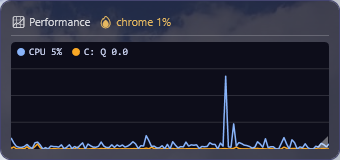
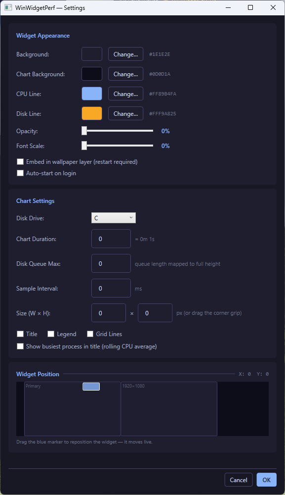

# WinWidgetPerf

A lightweight, transparent desktop widget that charts your PC's activity in real time: CPU load,
disk activity, network use, memory and temperature, drawn as a scrolling stripchart right on your
wallpaper.

- **Live stripchart:** CPU and disk on one chart, each in its own color, over a time span you choose.
- **Busiest process:** the title bar names the process using the most CPU, averaged over the chart
  window. Hover it to see the top three.
- **Network, memory and temperature gauges:** see how busy your connection is, how much memory is
  in use, and how warm the CPU and GPU are.
- **Yours to style:** colors, opacity, size, font scale and which parts are shown. Run several
  widgets on several monitors.
- **Private by design:** no account, no ads, no telemetry, and no internet connections. See the
  [privacy policy](privacy.html).
- **Free and open source** under the Apache 2.0 license.

## Download

Windows 10 or 11, x64 or ARM64. No .NET runtime needed.

- [Download the portable zip](https://github.com/landenlabs/win-widget-perf/releases/latest/download/WinWidgetPerf.zip):
  extract it and run `WinWidgetPerf.exe`
- [All releases](https://github.com/landenlabs/win-widget-perf/releases): MSIX installers (x64 and
  ARM64) and older versions
- [Installation help](https://github.com/landenlabs/win-widget-perf/blob/main/how-to-install.md)

## Using it

| Action | Result |
| --- | --- |
| Hover | Shows the Settings (⚙) and About (?) buttons and the resize grip |
| Drag the widget | Moves it (Windows 11; on Windows 10 use the position map in Settings) |
| Drag the corner grip | Resizes it |
| Right-click | Resource Monitor, Settings, About, Remove, Exit |
| System tray icon | Add another widget, open Settings, or exit |

## Support

- [Report a problem or ask a question](https://github.com/landenlabs/win-widget-perf/issues)
- [Source code and documentation](https://github.com/landenlabs/win-widget-perf)
- [Privacy policy](privacy.html)

&copy; 2026 LanDen Labs. Licensed under Apache-2.0.
